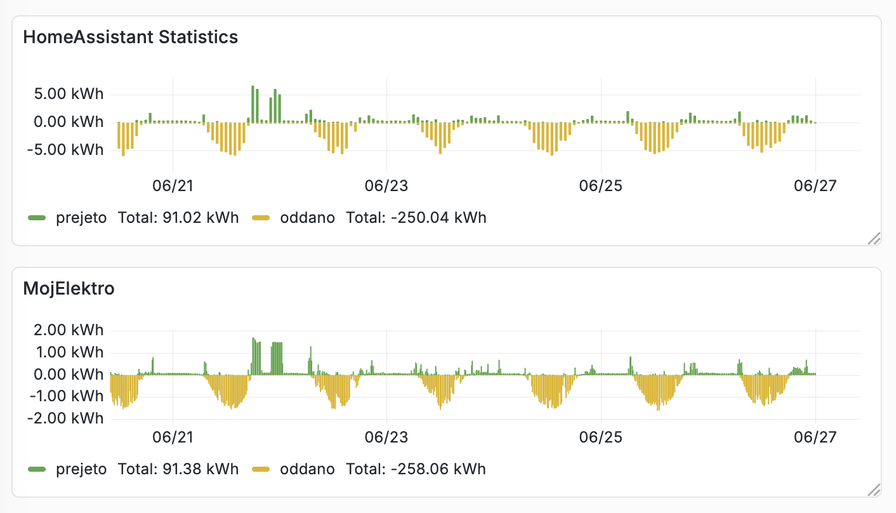
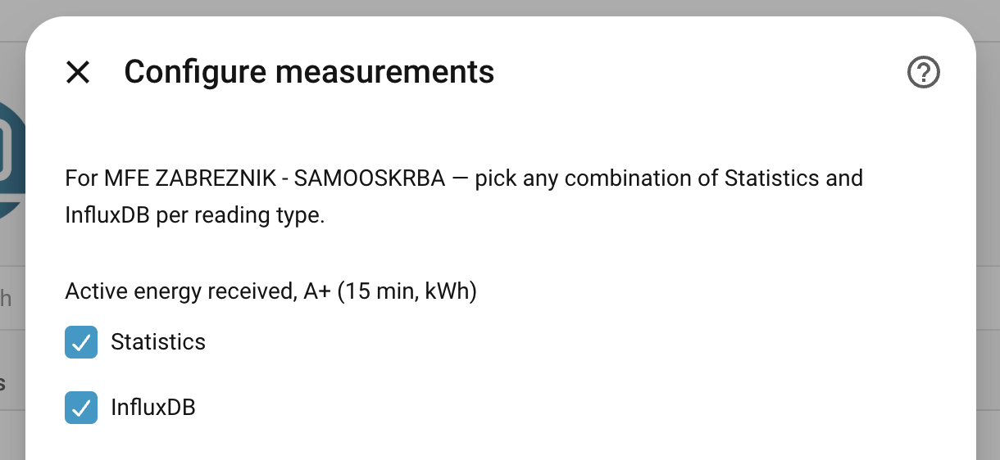
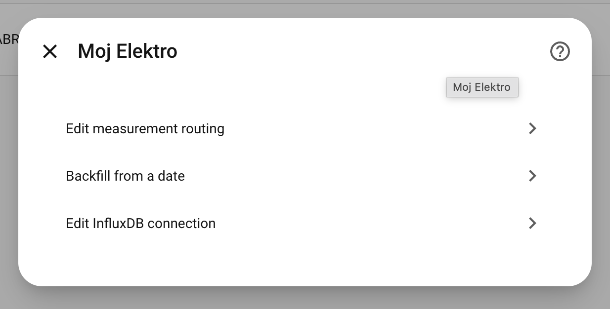

# Moj Elektro Stats

Home Assistant integration for [Moj Elektro](https://mojelektro.si) electricity data ([API docs](https://docs.informatika.si/mojelektro/api/)). Distributed as a [HACS](https://hacs.xyz/) custom component — self-contained, no extra Python packages to install.

## What it does

- Pulls meter readings from the Moj Elektro API on a schedule
- Imports historical data into Home Assistant **Statistics** (Energy dashboard, long-term charts)
- Optionally writes raw 15-minute readings to **InfluxDB v2** for selected data points
- Backfilling data up to 2 years ago
- Support for multiple meters and accounts

<table>
  <tr>
    <td> </td>
    <td> </td>
    <td> </td>
  </tr>
</table>

Get an API token at [mojelektro.si](https://mojelektro.si) (Account → API).

## Install (Marketplace / HACS)

Home Assistant 2026.11+ ships HACS built in as **Marketplace**.

1. **Settings → Marketplace** → ⋮ → **Custom repositories**, add `https://github.com/MarZab/mojelektro-stats` (category: **Integration**).
   On Home Assistant 2026.10 or older, do the same from HACS → ⋮ → **Custom repositories**.
2. Install **Moj Elektro Stats** and restart Home Assistant.
3. Add the integration via **Settings → Devices & Services → Add Integration → Moj Elektro Stats**.

Manual install: copy `custom_components/mojelektro_stats/` into your HA `config/custom_components/` directory and restart. The integration bundles its own typed API client under `lib/` — nothing else to install.

## Dashboard

The integration writes its data as Home Assistant **long-term statistics** (statistic IDs prefixed `mojelektro_stats:`), so there are two ways to chart it:

- **Energy Dashboard** — the energy reading types appear in **Settings → Dashboards → Energy** (they carry the right `unit_class`). Add the cumulative `A+`/`A-` registers there for grid consumption/return — including the per-tariff (VT/MT) splits.
- **`statistics-graph` card** — for power and anything else, add a [Statistics graph card](https://www.home-assistant.io/dashboards/statistics-graph/) and pick the `mojelektro_stats:…` statistics. Use `change` for cumulative energy and `mean`/`min`/`max` for power.

> **Upgrading from 1.0.0:** daily register readings used to show up one day late. To fix history that was already imported, run **Configure → Backfill from a date** with your earliest date. See the [changelog](CHANGELOG.md).

## Repository layout

| Path | Purpose |
|------|---------|
| `custom_components/mojelektro_stats/` | **The product** — HACS integration + vendored API client |
| `tests/`, `tools/` (CLI, scripts, mise tasks), `docker/`, `docs/` | Developer tooling — not shipped to HA users |

## Development

Contributors: see [`docs/development.md`](docs/development.md) for `uv sync`, `mise run check`, the local CLI, Docker dev stack, and cassette recording. AI-agent rules: [`AGENTS.md`](AGENTS.md).

## License

[MIT](LICENSE). Not affiliated with or endorsed by Moj Elektro or the Slovenian electricity distribution companies.
